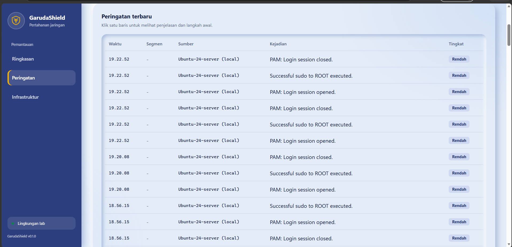

# GarudaShield

**Network Security Monitoring Dashboard**

GarudaShield adalah proyek pemantauan keamanan jaringan berbasis web yang mengintegrasikan MikroTik, Wazuh, dan FastAPI untuk membantu menampilkan serta menganalisis peringatan keamanan dari lingkungan jaringan.

## Dashboard Preview



GarudaShield menampilkan pemantauan keamanan jaringan melalui
integrasi Wazuh, backend FastAPI, dan dashboard web.


## Fitur

- Dashboard ringkasan peringatan keamanan.
- Daftar peringatan beserta tingkat keparahannya.
- Detail peringatan untuk membantu proses analisis.
- Integrasi data peringatan Wazuh melalui REST API.
- Penerimaan log jaringan dari MikroTik untuk kebutuhan pemantauan dan demonstrasi.
- Antarmuka web dengan navigasi ringkasan, peringatan, dan infrastruktur.

## Arsitektur

```text
MikroTik RouterOS
       |
       | Syslog
       v
Wazuh Security Monitoring
       |
       | Alert Data
       v
FastAPI Backend
       |
       | REST API
       v
GarudaShield Web Dashboard
```

## Teknologi

- **Network Device:** MikroTik RouterOS
- **Security Monitoring:** Wazuh
- **Backend:** Python, FastAPI
- **Frontend:** HTML, CSS, JavaScript
- **Environment Lab:** Ubuntu Server dan VirtualBox

## Struktur Proyek

```text
GarudaShield/
├── backend/
│   ├── main.py
│   └── requirements.txt
├── frontend/
│   ├── index.html
│   ├── css/
│   │   └── style.css
│   └── js/
│       └── app.js
├── .gitignore
└── README.md
```

## Status Proyek

Proyek ini dikembangkan sebagai prototipe dan laboratorium pembelajaran keamanan jaringan. Integrasi serta fitur yang ditampilkan bergantung pada konfigurasi layanan dan perangkat di lingkungan pengujian.

## Catatan

- Alamat IP dan konfigurasi layanan perlu disesuaikan dengan lingkungan masing-masing.
- Jangan menyertakan password, token, private key, atau informasi sensitif lainnya di repositori.
- Folder virtual environment (`.venv`) tidak perlu diunggah ke GitHub.

## Pengembangan Selanjutnya

- Penyempurnaan visualisasi statistik peringatan.
- Peningkatan penyaringan dan pencarian alert.
- Dokumentasi konfigurasi dan pengujian integrasi.
- Penambahan mekanisme autentikasi dan pengamanan API.

---

**GarudaShield — Network Security Monitoring Dashboard**
